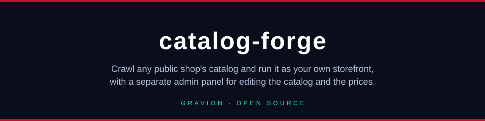

<p align="center"></p>

# Catalog Forge

[](https://github.com/gravion-ux/catalog-forge/actions/workflows/ci.yml) [](LICENSE)

**Crawl any public shop's catalog and run it as your own storefront, with a separate admin panel for editing the catalog and the prices.**

Catalog Forge reads a shop's public product pages, imports the products,
images, prices, variants and categories into a local SQLite database, and
serves them through a storefront of your own. The admin panel lets you edit
any product, adjust prices one at a time or in bulk, manage categories,
review orders and start new crawls.

## Legal note

Only crawl sites you have the right to copy. Respect each site's terms of
service and the rights of the content owner. The crawler honors `robots.txt`,
identifies itself honestly, and never bypasses a CAPTCHA, a paywall or a
login.

## Installation

```sh
# Clone the repository
git clone https://github.com/gravion-ux/catalog-forge.git
cd catalog-forge

# Create a virtual environment
python -m venv .venv
source .venv/bin/activate  # On Windows: .venv\Scripts\activate

# Install the backend
pip install -r backend/requirements.txt
pip install -r backend/requirements-dev.txt  # For development and testing

# Build the frontend
cd frontend
npm install
npm run build
cd ..
```

## Quick start

```sh
# Set the admin password (required)
export CATALOG_FORGE_ADMIN_PASSWORD="your-password"

# Run the server
python -m uvicorn app.main:app --app-dir backend
```

The `--app-dir backend` puts the `app` package on the import path.

Then open <http://localhost:8000> in your browser.

### Login to the admin panel

- **Username:** `admin` (default) or set `CATALOG_FORGE_ADMIN_USERNAME`
- **Password:** whatever you set in `CATALOG_FORGE_ADMIN_PASSWORD`

The admin panel is at <http://localhost:8000/admin/login>.

### Crawl a shop

1. Log into the admin panel.
2. Go to **Crawls → Crawl a shop**.
3. Enter the URL of the shop (e.g., <https://example-store.com>).
4. Wait for the crawl to complete. The admin dashboard shows the progress.

### Edit prices

Products imported from the crawl have a "source price" and a "live price".
Changes made through the admin panel:
- Set the live price (perpetual overrides the source)
- Apply a markup, delta, or absolute price to many products at once
- Edit the product details directly

A price you set by hand is never overwritten by a later crawl.

## Documentation

- [`docs/USER-GUIDE.md`](docs/USER-GUIDE.md) — how to crawl a shop and edit
  prices, step by step
- [`docs/API.md`](docs/API.md) — every endpoint with its request and response
  shapes

## License

MIT — see the `LICENSE` file for the full terms.
